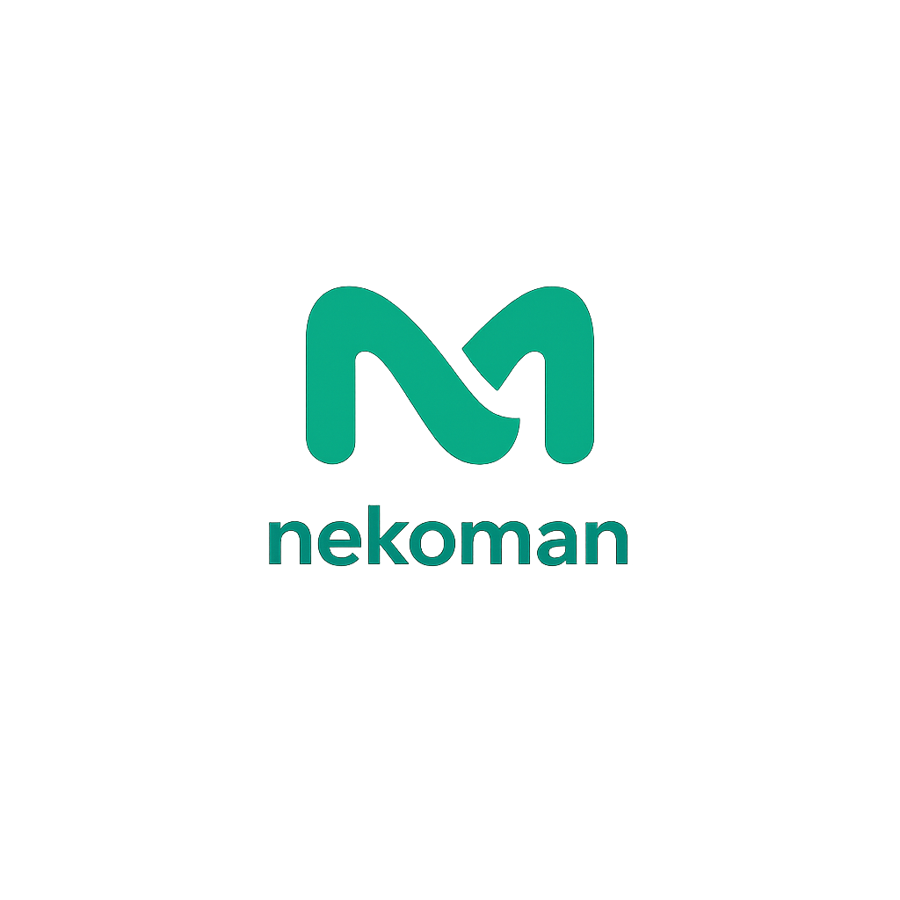
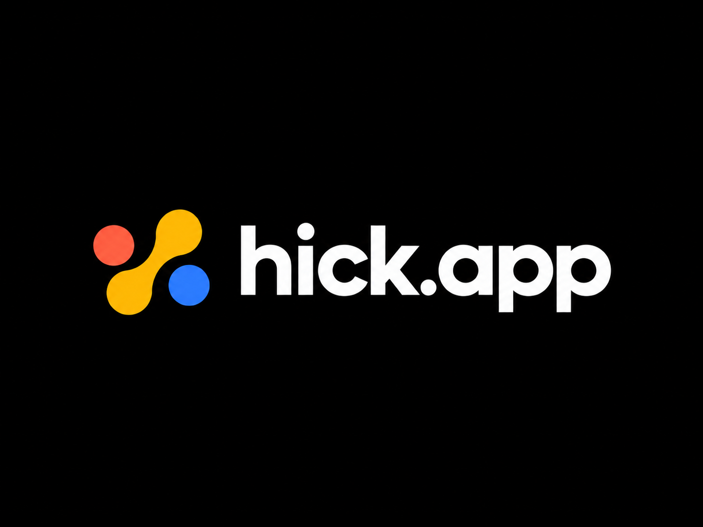
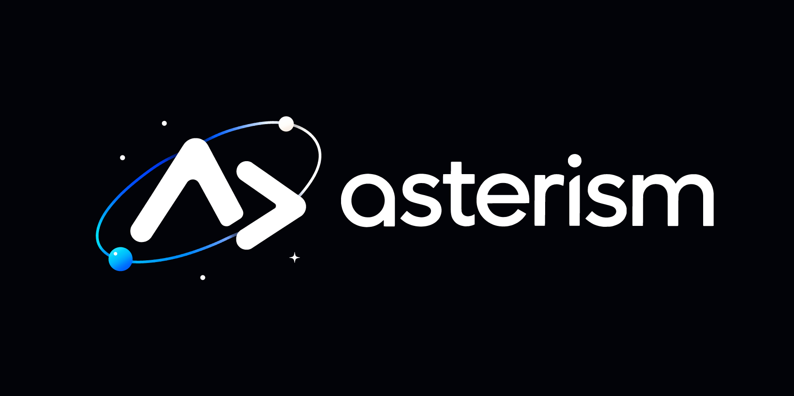

  

---

# nekoman

nekoman is a software company. We build and maintain our own software products and platforms, and we also give training talks on software topics. Each project lives in its own repository (or monorepo) with its own documentation and release cycle. Some repositories are open source, others are proprietary.

## Projects

### Hick

Mobile app that builds a content strategy for people who want to build a personal brand. It helps users turn rough ideas into structured short-form video projects, plan them, and take them through to a finished video.

- Monorepo with a mobile app (Expo / React Native), a desktop and web app (Tauri), a marketing website, and an API
- Local-first sync with PowerSync, file storage on S3
- Status: in development

### API Platform

The shared backend platform that our other projects build on. Services use the platform's starters instead of re-implementing common functionality, and each service keeps its own documentation site.

- **Identity**: accounts, organizations, and sign-in (email, Google, Apple, passkeys). Billing via Stripe is planned as a module inside Identity.
- **Bootstrap starter and projection framework**: the common structure every service is built on
- **Docs service**: collects the documentation of the platform and its services
- **Identity SDK**: TypeScript client generated from the OpenAPI specs, for React Native, React, and Tauri
- **platform-gradle-plugin**: Gradle plugins used to build the platform
- Status: in development

### Asterism

SSH client with a self-hosted backend, built for small teams. Runs as a desktop app on macOS and Linux.

- SSH and SFTP with a built-in file browser
- Shared vaults for team secrets, with end-to-end encrypted storage
- Server and network items that are discovered passively and shown as a topology map
- Local-first: each device keeps a local SQLite copy and syncs with the team backend
- Stack: Tauri with TypeScript on the client, Rust and Postgres on the backend
- Status: in development

### IceSportMaster

Real-time AI system for ice stock sport (Eisstockschießen). Detects and segments the stocks on the court from camera images and runs on an NVIDIA Jetson Orin Nano.

- Custom annotated dataset, RF-DETR models for detection and instance segmentation
- OpenCV for camera calibration, TensorRT for deployment
- Developed as a diploma project and customer project

## Deprecated

These projects are no longer developed. Their repositories are kept for reference.

- **Trainity**: fitness app for gym, running, and calorie tracking
- **Neko CLI**: our earlier command-line tool, discontinued
- Other older repositories and experiments

## Licensing

Open-source repositories contain a license file. Proprietary repositories are marked as such in their README. Check the repository before using any code.

## Contributing

For open-source repositories, read the repository's README and contribution notes, then open an issue or pull request describing the change. For larger changes, start a discussion first.

## Contact

Email: office@nekoman.at
